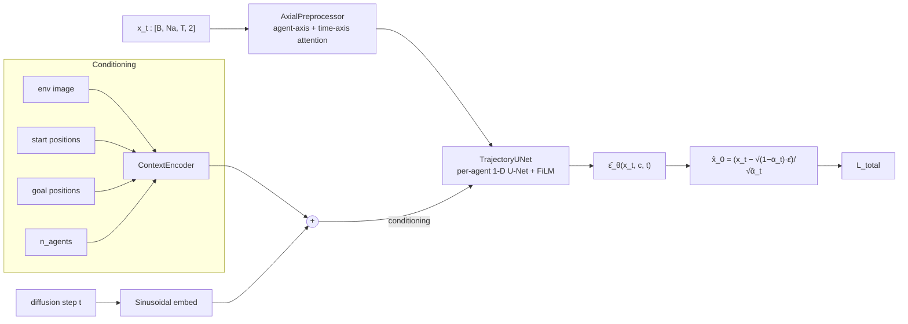

# MA-DBP — Multi-Agent Diffusion-Based Planner (clean reference)

A clean, faithful re-implementation of the MA-DBP planner from
[**Train-Small Deploy-Large: Leveraging Diffusion-Based Multi-Robot Planning**](https://arxiv.org/abs/2604.06598)
(Singh et al., 2026).

A single shared per-agent diffusion model — coupled across agents only by an
inter-agent **axial-attention** preprocessor and rolled out in a
**moving window** — generalises zero-shot from small training teams to
larger deployment teams in continuous multi-robot navigation.

> **Branch `paper-aligned`.** Defaults follow the paper (loss weights, pre-processor in
> the training path, Algorithm 2 sampling); original-code extras are off-by-default flags.
> Paper-vs-code table and open items: [`docs/paper_alignment.md`](docs/paper_alignment.md).
> Math: [`docs/math.md`](docs/math.md). Pipeline: [`docs/pipeline.md`](docs/pipeline.md).

> **Verification status.** The torch model/trainer, the MuJoCo arena and the VMAS layout
> provider were written without being run (no torch/MuJoCo/VMAS in the authoring
> environment). The torch-free simulation core (`madbp.sim`) is tested. Run `pytest` first;
> old `v2_2` diffusion checkpoints are **not** loadable and must be retrained.

---

## Pipeline



`L_total = 0.85·L_noise + 0.025·L_boundary + 0.025·L_temporal + 0.10·L_collision`
(paper Eq. 8; velocity/goal terms and Min-SNR weighting exist but are off by default).
Coefficients live in [`configs/madbp_navigation_v2.yaml`](configs/madbp_navigation_v2.yaml).

---

## Install

Requires Python ≥ 3.11.

```bash
git clone https://github.com/30Siddharth/madbp-clean.git
cd madbp-clean
git checkout paper-aligned

pip install -e ".[dev]"            # model, training, tests (CPU is fine for tests)
pip install -e ".[dev,mujoco]"     # + MuJoCo physics arena
pip install -e ".[dev,mujoco,sim]" # + VMAS (layouts/frames identical to the training renders)
```

The simulation core (`madbp.sim`, straight-line baseline) needs only `numpy`.

## Workflow

Each step needs the previous one.

### 0. macOS (Apple silicon or Intel)
Works. Use Python 3.11+ (e.g. `brew install python@3.12`, then `python3.12 -m venv .venv && source .venv/bin/activate`).
`pip install -e ".[dev,mujoco]"` installs arm64 wheels for torch and MuJoCo. `device: "auto"` picks
`mps` on Apple silicon (falls back to `cpu`); if you see an MPS "operator not implemented" error run
with `PYTORCH_ENABLE_MPS_FALLBACK=1`. Use a small config for local runs (e.g. `epochs: 20`,
`batch_size: 8`) and do the full 2000-epoch run on a CUDA workstation. VMAS rendering on macOS can be
fiddly; the built-in rasteriser and MuJoCo arena need no display.

**Fast end-to-end check with no real data** (a few minutes on a laptop):
```bash
python scripts/make_toy_dataset.py --out data/toy.h5 --episodes 64
sed -e 's#data/navigation_v2_Na_4_T_40_dataset.h5#data/toy.h5#' -e 's/epochs: 2000/epochs: 4/' \
    -e 's/save_every: 200/save_every: 2/' -e 's/num_workers: 4 .*/num_workers: 0/' -e 's/batch_size: 16/batch_size: 8/' \
    configs/madbp_navigation_v2.yaml > configs/toy.yaml
madbp-train --config configs/toy.yaml
python scripts/run_sim.py --planner madbp --checkpoint checkpoints/madbp_paper_epoch_00003.pth \
    --arena kinematic --kinds open --n-agents 4 --seeds 3 --out results/toy.csv
```
This only proves the pipeline runs; a 4-epoch model on random frames plans garbage.

### 1. Test
```bash
pytest            # tests/test_sim.py (no torch needed) + tests/test_smoke.py (torch)
```

### 2. Prepare data
Training reads an HDF5 file with one entry per episode under these groups
(shapes `[...]`; only XY is used):

| group | shape | note |
|---|---|---|
| `frames/<ep>` | `[F, H, W, 3]` | frame 0 is the scenario image; uint8 or float |
| `trajectories/<ep>` | `[T, Na, ≥2]` | expert (MAPPO) trajectories |
| `start_poses/<ep>`, `goal_poses/<ep>` | `[Na, ≥2]` | |
| `obstacles/<ep>` *(optional)* | `[M, 2]` | world-frame obstacle centres; enables the obstacle term of Eq. 7 |

Put it at the `h5_path` in the config (default `data/navigation_v2_Na_4_T_40_dataset.h5`).
Frames are rescaled to `[0, 1]` automatically; use the same image size/colour convention at
deployment as in the dataset.

### 3. Train
```bash
madbp-train --config configs/madbp_navigation_v2.yaml
```
Key config fields: `n_train_max` (largest team in training), `max_agents` (capacity at
deployment), `curriculum` (`linear_stage` | `sigmoid` | `none`), `stage_epochs`,
`loss_weights`, `d_min_world`/`d_obs_world`. Checkpoints (`checkpoints/*.pth`) store the model
config, normalisation statistics and mean window displacement, so evaluation needs only the path.
TensorBoard logs go to `runs/`.

### 4. Closed-loop simulation (feasibility results)
```bash
# Baseline (torch-free): straight-line sub-goals + PD tracker
python scripts/run_sim.py --planner straight --arena kinematic \
    --kinds open obstacles barrier corridor --n-agents 2 4 --seeds 20 --out results/straight.csv

# MA-DBP, MuJoCo physics, train-4 / deploy-4..10, with agents added and removed mid-episode
python scripts/run_sim.py --planner madbp --checkpoint checkpoints/madbp_paper_epoch_01999.pth \
    --arena mujoco --kinds open obstacles barrier --n-agents 4 6 8 10 --seeds 50 \
    --dynamic --out results/madbp_mujoco.csv
```
Useful flags: `--steps` (DDIM steps), `--init gaussian|linear` (`linear` is a warm start that is
*not* in the paper; report separately), `--no-pinning-cap` (ablation: use the final goal as
sub-goal), `--device cuda`. Scenario kinds: `open`, `obstacles`, `barrier`, `corridor`.
One CSV row per episode: success, goals reached, agent–agent and agent–obstacle collisions,
makespan, path length, jerk, tracking error, planning time, minimum pair distance.

How an episode runs: every `H-1` waypoints (and immediately after a team change) the executor
sets each agent's sub-goal (straight line to its goal, capped at the training window
displacement), samples a window with MA-DBP, and tracks the waypoints with a PD controller in
the arena. `Event(step, "add"|"remove", ...)` adds or drops agents by flipping the active mask.

To use VMAS-rendered scenario images instead of the built-in approximate rasteriser, see
`madbp/sim/vmas_layout.py`.

### 5. Legacy evaluator
```bash
madbp-eval --method madp --scenario barrier --n-agents 4 --n-episodes 50 \
           --checkpoint checkpoints/madbp_paper_epoch_01999.pth --out results/madp.csv
```
Same simulator, `EpisodeMetrics` CSV. Baselines `mappo`, `clf_qp`, `mmd`,
`projected_diffusion` are still stubs that raise `NotImplementedError`.

### Python API
```python
from madbp.sim.planners import MADBPPlanner
from madbp.sim.scenario import make_scenario
from madbp.sim.arena import PointMassArena
from madbp.sim.executor import run_episode, ExecConfig
import numpy as np

planner = MADBPPlanner("checkpoints/madbp_paper_epoch_01999.pth", device="cuda")
sc = make_scenario("barrier", 6, np.random.default_rng(0))
cfg = ExecConfig(replan_every=planner.horizon - 1, subgoal_cap=planner.window_disp_world or None)
print(run_episode(PointMassArena(sc, max_agents=planner.max_agents), planner, cfg).as_row())
```

---

## Repository layout

```
src/madbp/
  models/
    masks.py            # active-agent masks
    scheduler.py        # BoundaryAwareNoiseScheduler + SinusoidalPosEmb
    context.py          # ContextEncoder (env image + poses + count + attn)
    preprocessor.py     # AxialPreprocessor (inter-agent + temporal attn)
    unet.py             # TrajectoryUNet (per-agent 1-D U-Net w/ FiLM)
    losses.py           # boundary / temporal / collision (+ optional velocity, goal)
    diffusion.py        # MultiAgentDiffusionPlanner (single class, optional CFG)
  data/
    dataset.py          # HDF5 dataset, Batch(active mask), slot-shuffling collate
    frames.py           # shared image scaling (train == deploy)
  training/
    curriculum.py       # linear_stage / sigmoid / none
    trainer.py          # moving-window training loop + CLI
  sim/
    scenario.py         # layouts (open/obstacles/barrier/corridor) + add/remove Events
    arena.py            # numpy point-mass arena (test double)
    mujoco_arena.py     # MuJoCo physics, same interface
    executor.py         # receding-horizon closed loop + metrics
    planners.py         # MADBPPlanner (checkpoint) + straight-line baseline
    vmas_layout.py      # layouts/frames from VMAS
  evaluation/
    metrics.py          # EpisodeMetrics + helpers
    eval.py             # canonical CLI
    runners/            # MADPRunner + stubs for baselines
  utils/
    seed.py             # seed_everything

configs/                # YAML configs — one per experiment
scripts/run_sim.py      # closed-loop experiment driver
docs/
  pipeline.md           # data flow + ASCII diagram
  math.md               # full math contract
  changes.md            # P0 fixes + porting notes
  paper_alignment.md    # paper-vs-code table, text fixes for the paper
tests/                  # CPU smoke tests (run on every push)
.github/workflows/      # CI
```

## License

MIT — see [`LICENSE`](LICENSE).

## Citation

If you use this code, please cite the paper:

```bibtex
@article{singh2026trainsmall,
  title  = {Train-Small Deploy-Large: Leveraging Diffusion-Based Multi-Robot Planning},
  author = {Singh, Siddharth and others},
  journal= {arXiv preprint arXiv:2604.06598},
  year   = {2026}
}
```
