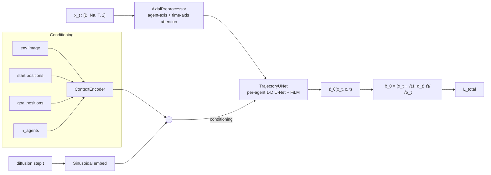

# MA-DBP — Multi-Agent Diffusion-Based Planner (clean reference)

A clean, faithful re-implementation of the MA-DBP planner from
[**Train-Small Deploy-Large: Leveraging Diffusion-Based Multi-Robot Planning**](https://arxiv.org/abs/2604.06598)
(Singh et al., 2026).

A single shared per-agent diffusion model — coupled across agents only by an
inter-agent **axial-attention** preprocessor and rolled out in a
**moving window** — generalises zero-shot from small training teams to
larger deployment teams in continuous multi-robot navigation.

> Status: structural rewrite of `30Siddharth/madbp` `v2_2`. Behavioural
> deltas are documented in [`docs/changes.md`](docs/changes.md).
> Math contract: [`docs/math.md`](docs/math.md). Pipeline diagram:
> [`docs/pipeline.md`](docs/pipeline.md).

---

## Pipeline



`L_total` decomposes into a Min-SNR-weighted denoising MSE plus boundary,
temporal-consistency, velocity, collision, and goal terms. Coefficients are
all in [`configs/madbp_navigation_v2.yaml`](configs/madbp_navigation_v2.yaml)
and the math is in [`docs/math.md`](docs/math.md).

## What's new vs. the arXiv v1 reference

This is a *structural* rewrite, not a redesign. Five P0 fixes change
results:

1. The axial preprocessor is now actually used during training (the v2_2
   code silently bypassed it via a linear projection).
2. The duplicated `compute_collision_loss` is deduplicated.
3. The total-loss formula is one explicit line, not three dead `if/elif`
   branches followed by a different total.
4. The agent-count curriculum is finally injected into the dataloader.
5. All auxiliary losses are vectorised; per-batch Python loops are gone.

Full audit: [`docs/changes.md`](docs/changes.md).

---

## Install

Requires Python ≥ 3.11.

```bash
git clone https://github.com/30Siddharth/madbp-clean.git
cd madbp-clean

# CPU-only quick start (good for tests + design work):
pip install -e ".[dev]"
# OR with VMAS for end-to-end eval (Linux + GPU recommended):
pip install -e ".[dev,sim]"
```

The CI installs the CPU-only torch wheel, runs `ruff`, and runs the smoke
tests — see [`.github/workflows/ci.yml`](.github/workflows/ci.yml).

## Quick start

### Smoke-test the pipeline (CPU, < 10 s)

```bash
pytest -q
```

### Train on a VMAS dataset

```bash
# Generate or download data/<scenario>_Na_<n>_T_<T>_dataset.h5 first.
madbp-train --config configs/madbp_navigation_v2.yaml
```

Checkpoints land in `checkpoints/`, TensorBoard logs in `runs/`.

### Evaluate

```bash
madbp-eval --method madp \
           --scenario navigation_v2 \
           --n-agents 4 \
           --seed 0 \
           --n-episodes 50 \
           --checkpoint checkpoints/madbp_navigation_v2_n4_epoch_01999.pth \
           --out results/madp_navigation_v2_n4.csv
```

One CSV row per episode, with metrics:
`success, final_goal_distance, n_collisions, collision_rate,
path_length_mean, makespan, mean_acceleration, mean_jerk, plan_runtime_s,
time_to_goal_mean, spl`. Aggregate across seeds/methods downstream.

Baseline runners (`mappo`, `clf_qp`, `mmd`, `projected_diffusion`) currently
raise `NotImplementedError` — they will be ported as Experiment 1
progresses; see [`docs/changes.md`](docs/changes.md).

---

## Repository layout

```
src/madbp/
  models/
    scheduler.py        # BoundaryAwareNoiseScheduler + SinusoidalPosEmb
    context.py          # ContextEncoder (env image + poses + count + attn)
    preprocessor.py     # AxialPreprocessor (inter-agent + temporal attn)
    unet.py             # TrajectoryUNet (per-agent 1-D U-Net w/ FiLM)
    losses.py           # All 5 auxiliary losses, vectorised
    diffusion.py        # MultiAgentDiffusionPlanner (single class, optional CFG)
  data/
    dataset.py          # HDF5 dataset + curriculum-aware collate_fn
  training/
    curriculum.py       # sigmoid + constant schedules
    trainer.py          # moving-window training loop + CLI
  sampling/             # reserved for future guidance modules
  evaluation/
    metrics.py          # EpisodeMetrics + helpers
    eval.py             # canonical CLI
    runners/            # MADPRunner + stubs for baselines
  utils/
    seed.py             # seed_everything

configs/                # YAML configs — one per experiment
docs/
  pipeline.md           # data flow + ASCII diagram
  math.md               # full math contract
  changes.md            # P0 fixes + porting notes
tests/                  # CPU smoke tests (run on every push)
.github/workflows/      # CI
```

## Roadmap: Distributed CBF backbone (follow-up paper)

A distributed control-barrier-function safety backbone for the diffusion sampler is sketched in [`docs/cbf_backbone.md`](docs/cbf_backbone.md). The interface is stubbed in `src/madbp/sampling/cbf.py` (currently `NotImplementedError`). Trainer, model, and dataset stay unchanged — the CBF is a deployment-time add-on. See the design doc for the math, the predicted-neighbor surrogate, and the experiment plan.

## License

MIT — see [`LICENSE`](LICENSE).

## Citation

If you use this code, please cite the paper:

```bibtex
@article{singh2026trainsmall,
  title  = {Train-Small Deploy-Large: Leveraging Diffusion-Based Multi-Robot Planning},
  author = {Singh, Siddharth and others},
  journal= {arXiv preprint arXiv:2604.06598},
  year   = {2026}
}
```
